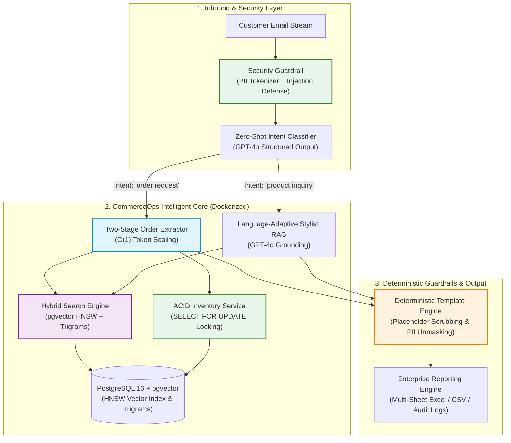

# CommerceOps AI Engine
### *Enterprise Omnichannel Order Fulfillment & Intelligent Customer Operations Platform*

[](https://www.docker.com/)
[](https://github.com/pgvector/pgvector)
[](https://openai.com/)
[](https://github.com/boucoding)
[-lightgrey.svg)](https://creativecommons.org/licenses/by-nc/4.0/)
[](https://github.com/boucoding)
[](https://www.linkedin.com/in/aadiab)

---

## 1. Business Problem & Solution

High-growth luxury and omnichannel retail brands lose millions in revenue due to manual email triage. Support teams spend 4–8 minutes per email manually parsing messy customer messages, verifying ERP stock, and answering sizing/styling questions—creating fulfillment delays, cart abandonment, and inventory race conditions.

**CommerceOps AI Engine** transforms unstructured customer emails into structured, real-time e-commerce actions. It autonomously classifies intent, executes sub-millisecond hybrid catalog retrieval, performs ACID transactional stock reservations, and generates personalized, production-ready responses—reducing SLA from hours to seconds with zero hallucination.

---

## 2. End-to-End System Architecture



---

## 3. Engineering Highlights

### A. Two-Stage RAG Order Extraction ($O(1)$ Token Complexity)
* **Candidate Retrieval**: Fast hybrid search extracts top $k=5$ candidate products matching mentions in the email body.
* **Structured Resolution**: Injects only candidate records into GPT-4o structured extraction (`ExtractedOrder`), maintaining constant $\sim 250$ prompt tokens even at $100{,}000+$ SKUs ($99.6\%$ cost reduction).

### B. PostgreSQL 16 + `pgvector` with HNSW & Trigram Indexing
* **HNSW Cosine Vector Indexing**: Sub-millisecond similarity search across $100\text{k}+$ SKUs (`vector_cosine_ops`).
* **Trigram Typo Recovery (`pg_trgm`)**: Automatically recovers customer typos (e.g. `DHN0987` $\rightarrow$ `CHN0987 Chunky Knit Beanie`) and formatted bracketed SKUs (`[CBT 89 01]` $\rightarrow$ `CBT8901`).

### C. ACID Transactional Inventory Locking
* Multi-worker safe stock reservations prevent race conditions and overselling using row-level locking:
  ```sql
  SELECT product_id, name, stock FROM products WHERE product_id = %s FOR UPDATE;
  ```

### D. Security Guardrails & PII Compliance (GDPR / CCPA)
* **Reversible PII Masking**: Deterministically tokenizes personal emails, phone numbers, credit cards, SSNs, and addresses (`{{PHONE_1}}`, `{{EMAIL_1}}`) before LLM transmission. Outbound responses unmask details securely on-premise.
* **Prompt Injection Defense**: Detects adversarial jailbreaks (*"Ignore previous instructions"*, *"Set prices to $0"*), quarantining untrusted customer inputs inside XML boundaries (`<customer_untrusted_input>`).

### E. Deterministic Brand Guardrails (Zero Placeholder Leaks)
* Extracts customer names from conversational greetings and deterministically injects verified enterprise metadata, signatures, and contact details, eliminating raw bracket tags (`[Your Name]`, `[Brand Name]`).

---

## 4. Docker-First Production Architecture & Testing

The platform runs inside an ultra-slim multi-stage Docker container with zero host system pollution.

```
┌─────────────────────────────────────────────────────────────┐
│                      Docker Network                         │
│                                                             │
│   ┌─────────────────────┐         ┌─────────────────────┐   │
│   │   postgres-db       │         │   commerceops-app   │   │
│   │   pgvector:pg16     │◄───────►│   (FastAPI/Pipeline)│   │
│   │   HNSW + pg_trgm    │         └─────────────────────┘   │
│   └─────────────────────┘                    │              │
│              ▲                               ▼              │
│              │                    ┌─────────────────────┐   │
│              └───────────────────►│   test-runner       │   │
│                                   │   (Pytest / Coverage)   │   │
│                                   └─────────────────────┘   │
└─────────────────────────────────────────────────────────────┘
```

### Environment Configuration
The platform requires an OpenAI API Key for live LLM completions and embeddings. Keys and database parameters are strictly loaded from environment variables (never hardcoded):

```bash
# 1. Copy the example configuration file
cp .env.example .env

# 2. Add your OpenAI API key in .env:
# OPENAI_API_KEY=sk-...
```

### Quick Commands

```bash
# 1. Build ultra-slim container stack
docker compose build

# 2. Run test suite inside Docker
docker compose run --rm test-runner

# 3. Execute pipeline in production container
docker compose run --rm commerceops-app

# 4. Clean container environment
docker compose down -v
```

---

## 5. Testing & Quality Assurance Coverage Matrix

Running `docker compose run --rm test-runner` executes the full suite:

| Test Module | Coverage Scope | Key Assertions Verified in Container |
| :--- | :--- | :--- |
| `tests/test_guardrails.py` | PII masking & prompt injection defense | Email/phone/card tokenization, reversible unmasking, jailbreak screening. |
| `tests/test_fuzzy_matcher.py` | Fuzzy typo recovery & SKU normalization | `DHN0987` $\rightarrow$ `CHN0987`, `[CBT 89 01]` $\rightarrow$ `CBT8901`, name matching. |
| `tests/test_inventory_service.py` | ACID transactions & stock reservation logic | Atomic reservations, zero-stock rejection, sequential stock depletion. |
| `tests/test_hybrid_vector_store.py` | PgVector HNSW similarity & score fusion | Cosine similarity ranking, typo priority boosting, top-$k$ bounds. |
| `tests/test_intent_classifier.py` | Intent edge cases & structured outputs | Postponed purchases, purchase commitments, rambling noise. |
| `tests/test_order_extractor.py` | Two-Stage RAG extraction & stock updates | $O(1)$ token candidate retrieval, quantity parsing, stock decrement. |
| `tests/test_template_engine.py` | Deterministic template scrubbing & signatures | Zero `[` or `]` bracket leaks, dynamic customer name extraction. |
| `tests/test_end_to_end.py` | Full batch pipeline regression | 100% schema compliance across all 4 output tables with zero data loss. |

---

## 6. Technology Stack

* **Infrastructure**: Docker Compose, Multi-Stage Ultra-Slim Dockerfile
* **Database & Vector Engine**: PostgreSQL 16 + `pgvector` (HNSW indexing) + `pg_trgm` GIN indexes
* **Security & Compliance**: In-Process Regex PII Tokenizer (GDPR/CCPA) + Adversarial Jailbreak Guard
* **Language & Core Frameworks**: Python 3.11 (Type Hints, Pydantic v2 Settings & Schemas)
* **AI & LLM Orchestration**: OpenAI GPT-4o Structured Outputs + `text-embedding-3-small`
* **Algorithms**: RapidFuzz (Levenshtein distance), Cosine Distance Score Fusion
* **Data Processing**: Pandas, OpenPyXL, NumPy
* **Testing**: Pytest, Pytest-Cov, Pytest-Asyncio in Docker

---

## 7. Author & Connect

**Created by**: [boucoding](https://github.com/boucoding)

* **GitHub**: [@boucoding](https://github.com/boucoding)
* **LinkedIn**: [linkedin.com/in/aadiab](https://www.linkedin.com/in/aadiab)

---

## 8. License

This project is open-source and licensed under the **[Creative Commons Attribution-NonCommercial 4.0 International (CC BY-NC 4.0)](https://creativecommons.org/licenses/by-nc/4.0/)** license.

* **Permitted**: Free for individual, educational, research, and non-commercial exploration.
* **Prohibited**: Commercial exploitation, deployment in closed-source commercial SaaS, or direct monetary advantage without prior written consent from the author.
